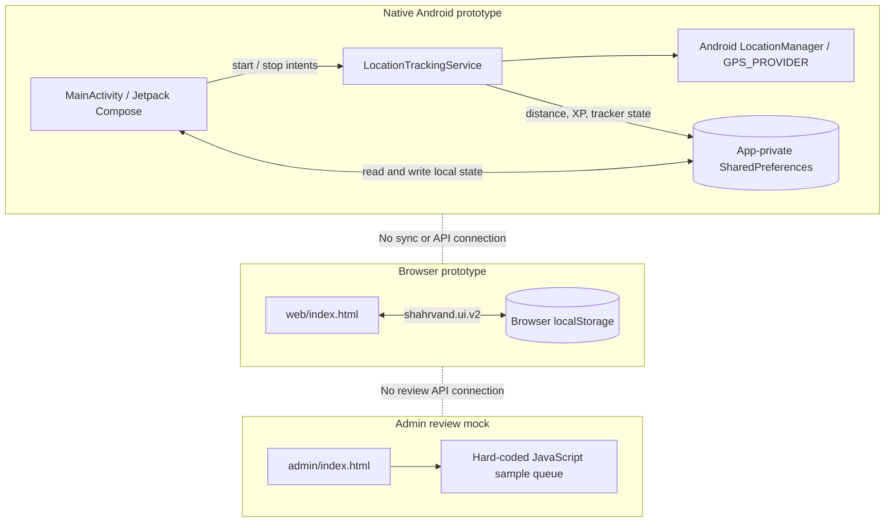

# SHAHRVAND — Architecture

**Scope:** `uiux/v1-prototype`, inspected at commit `108c0c2ea45eeb7f51dbab5b7ff44cbe5ef091f3` on 2026-11-24.

## 1. System context

The repository currently contains three independent client-side surfaces. They do not share a backend or a common data store.

Dashed lines in this diagram indicate the absence of an integration, not an implemented network connection.

## 2. Android application

### Entry point and UI

- Android application ID and Kotlin namespace: `tj.shahrvand.app`.
- Entry activity: `MainActivity`.
- UI toolkit: Jetpack Compose with Material 3.
- The activity owns the main navigation and most of the state/mission logic.
- Main sections: Home, Missions, Ranking, and Profile.
- UI language selection is implemented in client code for Tajik, Russian, and English.

The current implementation is intentionally compact: mission definitions, badge rules, UI state, local persistence calls, and screen composables are concentrated in `MainActivity.kt`. There is no separate domain/data layer, repository abstraction, ViewModel layer, or network client in the inspected source.

### GPS service

`LocationTrackingService` is an Android `Service` that implements `LocationListener`. The activity starts and stops it through explicit service intents.

Processing sequence:

1. Check that GPS is enabled and precise-location permission is available.
2. Start a location foreground service with an ongoing notification.
3. Request GPS provider updates every 2.5 seconds.
4. Reject low-quality fixes and implausible time, distance, or speed segments.
5. Average the latest five accepted speed samples.
6. Classify accepted distance as running or walking using the 1.72 m/s threshold.
7. Update daily distance and current segment counters in app-private preferences.
8. Complete the selected GPS mission once its configured distance target is reached.

The thresholds and limitations are recorded in [Technical status](TECHNICAL_STATUS.md#43-gps-tracking). This is not a machine-learning classifier.

### Android local data

The application uses app-private `SharedPreferences` named `shahrvand_local`. The same preference file is used by the activity and GPS service. It stores profile fields, language, test mode, XP, completed/pending mission IDs, badges, and GPS counters/status.

No API, remote database, token storage, backend authentication, or cloud synchronization is implemented in this branch.

## 3. Browser application

`web/index.html` is a self-contained page with inline CSS and JavaScript. It uses DOM rendering and browser `localStorage` under `shahrvand.ui.v2`.

The browser page has its own demo mission definitions, profile state, sample ranking fixtures, and badge data. It is not a web client for the Android app: it neither reads Android preferences nor communicates with the native application.

No package manager, frontend bundler, server framework, or API endpoint is defined in the inspected browser source.

## 4. Admin review mock

`admin/index.html` is a separate static page. Its review queue is a fixed JavaScript array containing three sample items. Approve/reject actions mutate those objects in memory and repaint the page.

There is no login, session management, administrator role, audit log, persistent queue, upload endpoint, or API call. It is therefore a UI demonstration only and must not be used to approve real user submissions.

The current `web-preview.yml` workflow uploads the `web/` directory only. It does not package `admin/`.

## 5. Deployment boundary

The repository's default branch is `main`, but the implementation described here lives on `uiux/v1-prototype`. The implementation branch contains:
- `android-ui.yml` for debug APK builds;
- `web-preview.yml` for a static Pages deployment from `web/`.

The default branch separately contains `static.yml` and `jekyll-gh-pages.yml`, both triggered by pushes to `main`. These are separate Pages publishers. The most recently observed main-branch Jekyll run succeeded; the static publisher's most recently observed run failed at deployment. The repository therefore has more than one Pages deployment path and should be reduced to one deliberate publishing configuration before production use.

## 6. Architectural gaps for a future backend

The following are not present in the current source and are listed as gaps, not existing components:

- user identity and authentication;
- server-side profile and mission records;
- proof upload and secure object storage;
- administrator authentication and permission checks;
- review workflow with immutable audit history;
- server-side XP calculation and badge awarding;
- authoritative leaderboard queries;
- validation against GPS spoofing and duplicate submissions;
- API contracts, database migrations, backups, and monitoring.

Any future backend must become the authority for verification and rewards. Client-side XP, completion IDs, and GPS-derived distances can be modified on a user's device and cannot independently establish verified activity.
