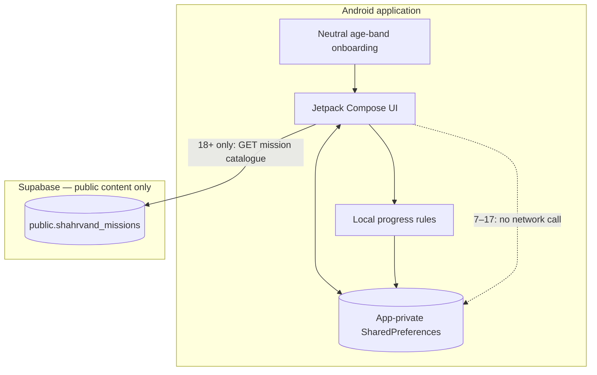

# SHAHRVAND — V1 Architecture

**Branch:** `release/v1.0.0` · **Version:** 1.0.0

## System boundary

V1 has one native Android client and one read-only public content endpoint for the 18+ age band.

The 18+ request reads public mission content only. There is no user authentication, profile synchronisation, user progress upload, or write path.

## Android

Single Gradle module: `:app`.

- `MainActivity.kt`: onboarding, age gate, Home/Missions/Progress/Future screens, mission cards, XP, achievements, settings, and language selection.
- `Mission`: shared data model for translated mission titles/descriptions and reward metadata.
- `ProgressRules.kt`: pure level, duplicate-completion, and daily-progress functions.
- `SupabaseMissionRepository.kt`: read-only 18+ HTTP client; no profile fields are included. Errors return null so bundled missions remain available.
- `app/src/test/`: unit tests for local progress rules.

No location service, media uploader, user repository, auth module, or user backend is present.

## Local persistence

Preferences file: `shahrvand_v1`.

Stored keys: `language`, `age_band`, `nickname`, `total_xp`, `total_completed`, `progress_day`, and `completed_today`. The daily set is reset when the app is opened on a new local calendar date. Reset Settings clears app data.

## Age-gated network logic

The onboarding presents 7–12, 13–17, and 18+ choices.

- 7–12 and 13–17 use bundled data. Supabase repository is not called.
- 18+ may fetch active public missions. No user-specific fields or auth token are sent.
- Failed fetch falls back to bundled content.

## Supabase table

`public.shahrvand_missions` contains curated public content only. RLS is enabled. The public Data API role has SELECT permission only and the policy returns active rows. There is no public insert/update/delete policy.

The connected project is shared with other Khayom1 applications; SHAHRVAND uses only this prefixed table.

## Trust model and deferred features

XP is local and self-reported. It is not tamper-proof or independently verified. V1 therefore has no public leaderboard, cash reward, or official civic-impact claim.

Evidence review, admin moderation, accounts, server-side rewards, sync, and rankings require a separate backend design, authentication/authorization, audit history, abuse controls, and a privacy review before implementation.
